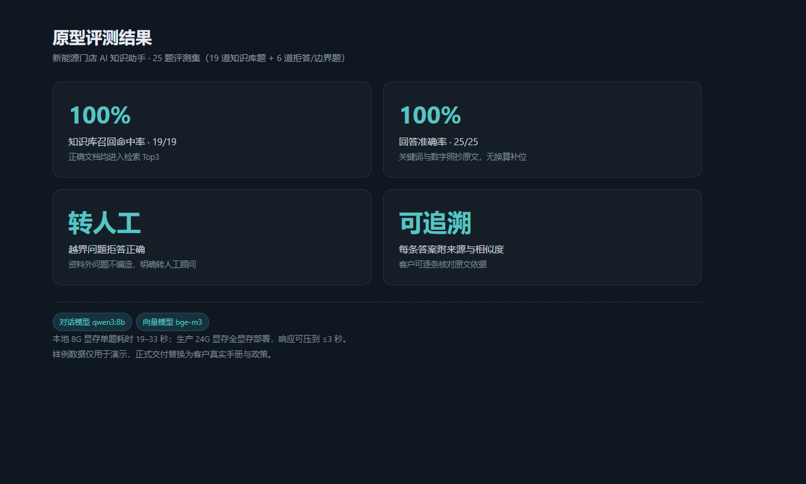
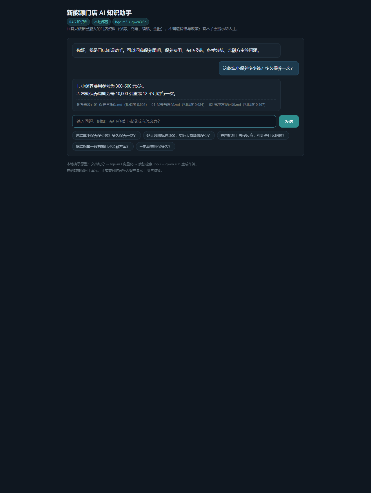
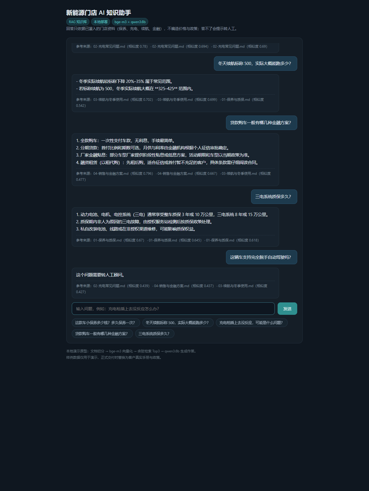

# 门店 AI 知识助手（RAG 问答原型）

一个可本地跑通的 **Retrieval-Augmented Generation（检索增强生成）** 演示原型：把门店手册、FAQ、政策等文档灌入知识库，问答时先检索原文再由大模型作答，**答案附来源可核对**；资料里没有的问题自动转人工，不编造价格、参数或政策承诺。

示例场景为新能源汽车销售与售后（保养质保、充电 FAQ、续航、金融方案、接待话术、异议跟进），可替换为任意行业的文档知识库。

## 演示效果

| 评测指标 | 结果 |
| --- | --- |
| 评测题数 | 25（19 道知识题 + 6 道拒答/边界题） |
| 召回命中率 | 19/19 = 100%（拒答题不考核召回） |
| 回答准确率 | 25/25 = 100% |

> 指标在本机 Ollama `qwen3:8b` + `bge-m3` 上实测；更换模型、文档或评测集后结果会变化。





## 功能特性

- **文档切块入库**：Markdown / TXT 文档按段落切块并做重叠，bge-m3 向量化，带本地缓存（文档不变则复用向量）。
- **检索 + 生成**：余弦相似度 Top-K 检索，大模型仅依据检索到的资料作答，逐条引用来源与相似度。
- **边界约束**：数字、里程、金额、年限要求原样照抄；资料无结论的功能承诺、竞品对比、残值、审批结果、交付周期、礼包等问题，先给原则口径再以"转人工顾问"收尾。
- **网页问答界面**：标准库 `http.server` 实现，无额外前端框架；提供预置问题快捷入口。
- **可复现评测**：评测集覆盖知识问答与拒答边界，脚本输出召回命中率、关键词准确率与逐题明细。

## 技术栈

- Python 3.10+，依赖 `ollama`、`numpy`
- 本地模型服务：[Ollama](https://ollama.com)
- 向量模型：`bge-m3:latest`；对话模型：`qwen3:8b`（请求时 `think=false`）
- 检索：numpy 余弦相似度（无 FAISS / Chroma 重依赖，便于轻量起步）

## 目录结构

```
rag-knowledge-assistant-demo/
├── rag.py              # RAG 核心：切块、向量化、检索、生成；批量/交互两种模式
├── app.py              # 本地网页服务（/ 页面，POST /api/ask）
├── index.html          # 对话界面
├── eval.py             # 评测脚本：召回命中率 + 关键词准确率 + 拒答判定
├── eval_set.json       # 评测集（问题、期望来源、必中关键词、是否拒答）
├── questions.txt       # 批量演示问题
├── docs/               # 样例知识库（6 份虚构演示文档）
├── shots/              # 演示截图与横版封面
├── requirements.txt
├── Dockerfile          # 应用镜像；Ollama 模型服务独立部署
└── .dockerignore
```

## 快速开始

### 1. 前置条件

- 安装并启动 [Ollama](https://ollama.com)，拉取所需模型：

```bash
ollama pull bge-m3
ollama pull qwen3:8b
```

### 2. 安装依赖

```bash
pip install -r requirements.txt
```

### 3. 运行

```bash
# 网页版（默认 http://127.0.0.1:8000）
python app.py

# 命令行批量跑 questions.txt，结果写入 answers.md
python rag.py --run

# 交互式问答
python rag.py

# 跑评测集，输出召回率 / 回答准确率与 eval_report.md
python eval.py
```

### 连接远程或非默认 Ollama 地址

```bash
# Linux / macOS
export OLLAMA_API=http://localhost:11434
# Windows PowerShell
$env:OLLAMA_API="http://localhost:11434"
```

> 注意：`OLLAMA_HOST` 是 Ollama 服务端监听地址，不要直接当作客户端连接地址；客户端地址用独立的 `OLLAMA_API` 环境变量。

## 关键配置（`rag.py` 顶部）

```python
EMBED_MODEL = "bge-m3:latest"
CHAT_MODEL  = "qwen3:8b"
CHUNK_SIZE  = 320
CHUNK_OVERLAP = 60
TOP_K       = 3
# 生成参数：temperature=0.2, num_predict=512, repeat_penalty=1.1
```

## 接入自己的资料

1. 把真实文档（PDF / Word / Markdown / TXT / 表格导出文本）放入 `docs/`；
2. 重启服务，向量缓存会按文档变化自动重建；
3. 在 `eval_set.json` 补充高频问题与验收口径，作为交付验收依据。

## 已知边界与局限

- 样例数据均为虚构演示，不代表任何真实品牌的价格、政策或承诺；正式交付以客户提供的正式资料为准。
- 本地 8G 显存跑 8B 模型会部分落内存，单题响应偏慢；生产环境建议更大显存或云端 API。
- 当前为单用户演示，未含多用户权限、后台管理与知识库在线编辑；正式产品可对接 MaxKB / AnythingLLM 等方案。
- 第三方模型调用费用按实际用量结算，建议设置用量封顶；服务器 / GPU 等硬件由使用方自备，本项目只交付软件层。

## 踩坑记录（换环境时参考）

1. **数字约束模型照抄**：小模型容易把 10,000 说成 1000、300 说成 130；system prompt 需明确"数字原样照抄，禁止换算补位"。
2. **thinking 模型 content 为空**：需传 `think=false`，代码同时兜底读取 `thinking` 字段。
3. **重复卡死**：设置 `repeat_penalty` 与 `num_predict` 上限，单题失败不中断整批。
4. **显存不足**：8G 显存跑 8B 部分落内存可用；生产建议 24G 显存跑全显存。

## License

MIT（发布时按需确认）。
